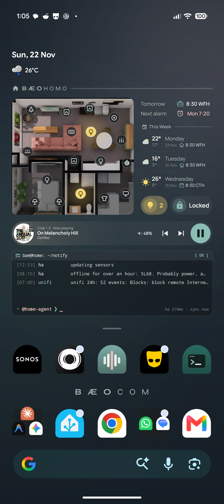
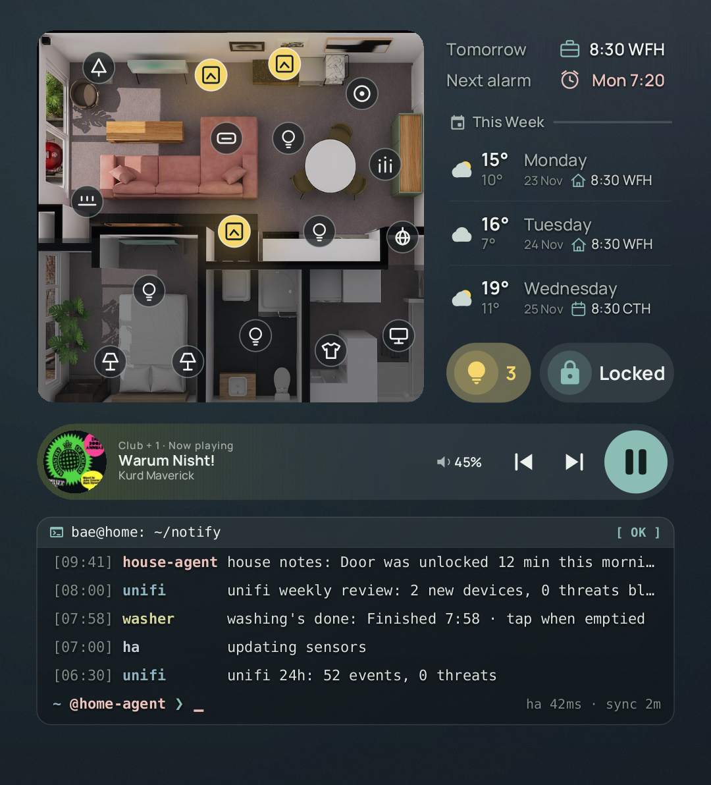
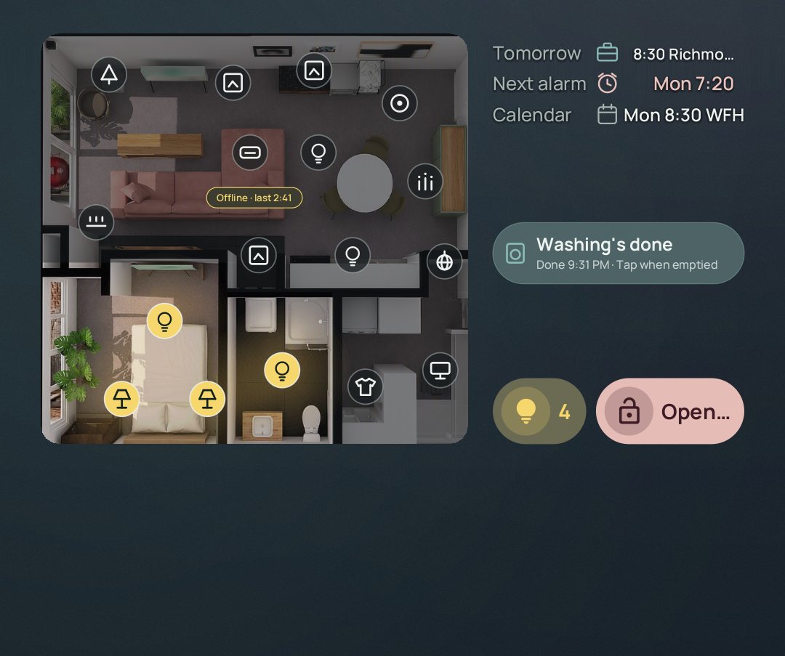

# Bæo Home widget

The home screen widget on my Pixel 10a. One glance tells me what the flat is doing, one tap changes it, and it keeps working when I'm out.

## What's on it

- **Floorplan with real buttons.** A render of the flat with a button on every light, plus the disco ball. Lit ones go yellow, dark rooms fade back. Tap one, it toggles.
- **Tomorrow and Next alarm.** Where I'm working next and when, and my next alarm. Tap either and the Clock app opens.
- **This Week.** Three day cards: weather, the date, and that day's calendar event (WFH, or the office as a short code). Tap a day and the calendar opens on it.
- **Lights and door.** Bubble-style buttons on the floorplan's edge. The bulb shows how many lights are on and turns them all off. The door locks in one tap; unlocking takes two, because a pocket should never let anyone in. Leave it open and it shows how long.
- **Now playing.** A Bubble Card style pill for the Club Sonos: round art with its colour washed across the card, title, artist, volume, skip and a big play button. Tap the art and my Sets app opens.
- **A terminal.** The last five Home Assistant notifications as log lines (house agent notes, UniFi reviews, the washer, health checks), each source in its own colour. The title bar says `[ OK ]` or `[WARN] door unlocked`, the corner shows HA latency and the last sync. Tap the prompt and you can type to my house agent: `status`, `waiting`, or just ask it something.

If the house needs something (a leak, the washing's done), an alert card takes the weather's place until it's sorted.

## Why it's like this

- **No box.** It sits on the wallpaper like At a Glance. The wallpaper carries a BÆOHOMO heading and a separator, so the screen still reads in sections.
- **One look, everywhere.** Same Sea glass palette and fonts (Manrope, Syne) as my TV, Nest Hubs and remotes, and the same floorplan.
- **Phone-first, not dashboard-first.** Everything I check ten times a day, nothing I check once a week.
- **Retro where it's fun.** The notifications are a terminal because that's how they feel: a log of my house.

## How it works

1. `HaClient` pulls `/api/states` from Home Assistant every few minutes (every minute while music plays) and the work calendar for the next few days, and caches it.
2. `BaeoHomeRender` draws the whole widget into one bitmap. `geo()` decides where everything sits and the provider places every tap zone from the same rects, so the picture and the touch targets can't drift apart.
3. `BaeoNotifyListener` reads only the Home Assistant app's notifications for the terminal (needs notification access).
4. `AgentTerminalActivity` is the little terminal that pops up over the home screen and posts commands to the house agent.

### Away from home (Cloudflare)

LAN first, always. If the LAN can't be reached:

- **Home Assistant** goes to its public hostname through a Cloudflare Tunnel. Access lets that host through and the HA token is the gate (the HA companion app can't send Access headers anyway).
- **The house agent** goes to its own hostname behind Cloudflare Access, using a **service token** made just for this widget. Access only admits that token, and the agent also checks Access's signed JWT is from it, plus its own command token.
- After a LAN failure the widget stays on the cloud route for five minutes, then tries home again. The terminal's corner says `cloud 350ms` instead of `ha 40ms`, so I can see which way it went.

## Build

No Gradle. `build.sh` compiles with the Android SDK build tools.

1. Copy `local.properties.example` to `local.properties` and fill it in (HA URL and token, calendar entity, optional agent and Cloudflare bits, signing).
2. Put your own floorplan in `assets/floorplan.png` and list your lights and their positions in `HomeState.FX_*`.
3. `./build.sh`, then `adb install -r baeo-widgets.apk`.

`tools/preview.sh` renders the widget on a desktop with made-up data (a small `android.graphics` shim over Java2D), so most of the design work happens without a phone.

Fonts: Manrope and Syne (SIL OFL), Material Icons Rounded (Apache 2.0).
